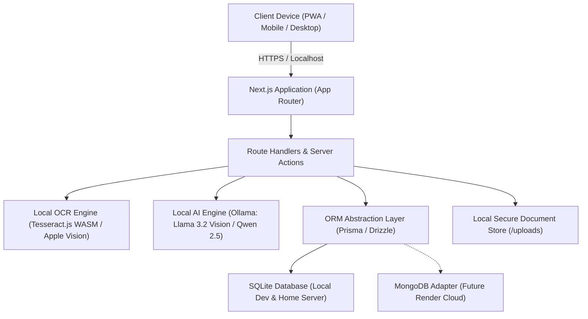
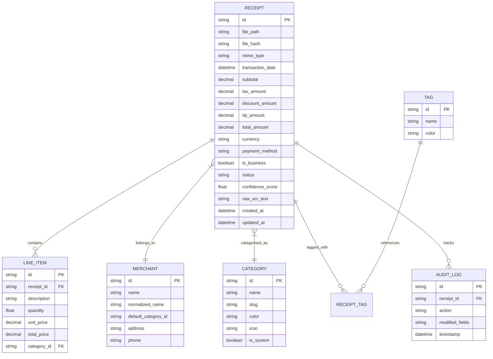

# Software Requirements Specification (SRS)
## Project: MoRecu — Intelligent Local-First Receipt & Expense Management PWA
**Document Version:** 1.0.0  
**Date:** 17/11/2026  
**Author:** Nirmal Rampersand  
**Status:** Approved for Implementation Planning  

---

## 1. Introduction

### 1.1 Purpose
This document provides a formal, comprehensive Software Requirements Specification (SRS) for **MoRecu**, an intelligent, privacy-first receipt digitisation and personal finance analytics Progressive Web Application (PWA). It defines functional requirements, non-functional constraints, technical architecture, data schemas, and acceptance criteria to guide engineering implementation.

### 1.2 Scope
MoRecu enables users to capture, digitise, categorise, analyse, and audit financial transactions from receipts (images, PDFs, and camera captures) without relying on external cloud APIs. The system operates locally on Apple Silicon hardware (macOS M4 architecture) and local home servers (M4 Mac mini), with future containerised cloud deployment capabilities on Render.

### 1.3 Definitions, Acronyms, and Abbreviations
- **PWA**: Progressive Web Application (installable, offline-capable web application with service workers and app manifest).
- **OCR**: Optical Character Recognition (conversion of image text to machine-encoded text).
- **VLM / LLM**: Vision-Language Model / Large Language Model running locally via Ollama.
- **ORM**: Object-Relational Mapping (abstraction layer between application code and relational/document databases).
- **SRS**: Software Requirements Specification.
- **KPI**: Key Performance Indicator (e.g., Burn Rate, Monthly Run Rate, Average Transaction Value).
- **pHash**: Perceptual Hash (used for visual receipt duplicate detection).

---

## 2. Overall Description

### 2.1 Product Perspective & Context
MoRecu is designed as a local-first, highly responsive web application. It runs with zero external telemetry or mandatory third-party cloud subscriptions, ensuring total user data sovereignty.
- **Primary Execution Host:** Local M4 MacBook Pro & M4 Mac mini server.
- **Client Devices:** Desktop browsers (Safari, Chrome) and mobile PWA installations (iOS Safari PWA, Android Chrome PWA).
- **Cloud Readiness:** Architected to run cleanly within standard Node.js runtime environments (e.g., Render) with pluggable storage and database adapters.

### 2.2 User Characteristics
- **Personal Finance Managers:** Users seeking granular tracking of daily retail, grocery, and recurring personal expenses.
- **Freelancers & Solopreneurs:** Small business owners requiring receipt archiving, business vs. personal expense segregation, tax compliance grouping, and audit exports.
- **Privacy-Conscious Individuals:** Users who explicitly refuse to send bank statements and personal receipt documents to third-party cloud LLM APIs.

### 2.3 General Constraints
1. **Zero External API Dependency:** Core OCR, extraction, categorisation, and conversational querying must run 100% offline/locally using Apple Silicon acceleration.
2. **Apple Silicon Optimisation:** The AI extraction pipeline must utilise Apple Silicon unified memory and Metal/Neural Engine acceleration (via Ollama or local inference backends).
3. **PWA Compliance:** Lighthouse PWA score $\ge 90$, standalone display mode, service worker caching, and direct camera capture via `MediaDevices` / `<input capture>`.
4. **Snappy & High Performance:** UI interactions under 16ms (60fps); cold dashboard loads under 300ms; local OCR processing completed within 1.5–3.5s per receipt on M4.
5. **Modern, Non-AI Aesthetic:** Bespoke typography, strict visual hierarchy, fluid micro-interactions, dark/light theme switching, and avoidance of generic template artifacts.

---

## 3. Product Features & Requirements

### 3.1 Core Features (MVP - Phase 1 & 2)

#### 3.1.1 Automated Receipt Ingestion & Local OCR (FR-1)
- **FR-1.1:** Direct capture via camera interface in PWA on mobile and desktop file dropzone (supports JPEG, PNG, WebP, HEIC, and single/multi-page PDF).
- **FR-1.2:** Multi-stage local extraction pipeline:
  - *Primary OCR Layer:* Fast local text extraction via `tesseract.js` (WebAssembly/Node) or macOS Vision framework CLI.
  - *Secondary Semantic Extraction:* Structured JSON parsing using a local quantized Vision-Language model (e.g., `llama3.2-vision` or `qwen2.5-coder/mistral` via local Ollama).
  - *Tertiary Heuristic Fallback:* Regular-expression and rule-based parser for dates, totals, VAT/tax numbers, and common currencies when Ollama is offline.
- **FR-1.3:** Extracted field mapping:
  - Merchant Name
  - Transaction Date & Time
  - Currency ($USD, €EUR, £GBP, MUR, etc.)
  - Line Items (Item description, quantity, unit price, total price)
  - Subtotal, Tax/VAT amount, Discounts/Coupons, Tip, Total Amount
  - Payment Method (Cash, Visa, Mastercard, AMEX, Apple Pay, Unknown)
- **FR-1.4:** Extraction Confidence Scoring: Visual progress bar and field-level confidence indicator highlighting uncertain fields for quick manual review.
- **FR-1.5:** Duplicate Detection:
  - Perceptual image hashing (pHash) for identical image uploads.
  - Transactional deduplication: Flag receipts matching `(merchant_id, date, total_amount)` within $\pm 24$ hours.

#### 3.1.2 Verification & Expense Management (FR-2)
- **FR-2.1:** Split-screen verification drawer displaying the uploaded receipt image (with zoom, rotate, and pan) side-by-side with extracted form fields.
- **FR-2.2:** Dynamic line-item editing (add, remove, adjust prices, edit tax rate).
- **FR-2.3:** Category assignment:
  - Default categories: Groceries, Dining & Restaurants, Transport & Fuel, Utilities, Housing, Office & Tech, Subscriptions, Healthcare, Entertainment, Miscellaneous.
  - Custom user-defined categories with custom colors and icon pickers.
- **FR-2.4:** Personal vs. Business expense toggle with tag support (e.g., `#ClientMeeting`, `#Deductible`).
- **FR-2.5:** Manual transaction entry without an image for cash or paperless transactions.

#### 3.1.3 Financial Analytics & Dashboard (FR-3)
- **FR-3.1:** Multi-timeframe aggregation:
  - Monthly: Spending overview, daily breakdown, month-over-month $\Delta\%$.
  - Quarterly: Q1–Q4 aggregate spending, category variance analysis.
  - Half-Yearly: 6-month budget evaluation and trajectory.
  - Yearly: Annual tax year analysis, historical trend curves.
  - Custom Range: Date-picker bounded queries.
- **FR-3.2:** Core Visualisations (Tailwind + Chart.js / Recharts):
  - Category Donut / Treemap breakdown.
  - Cash outflow timeline / stacked bar chart (Category vs. Time).
  - Top Merchants leaderboard.
  - KPI Cards: Total Spent, Daily Average, Top Category, Discretionary vs. Fixed Ratio.

#### 3.1.4 Document Vault & Search (FR-4)
- **FR-4.1:** Encrypted/sanitised local filesystem storage of raw receipt files with UUID naming and MIME-type validation.
- **FR-4.2:** Instant full-text search across merchant name, line items, notes, tags, and categories.
- **FR-4.3:** Multi-facet filters: Date range, amount range, category, payment method, review status (Pending / Verified).

#### 3.1.5 Data Export & Reporting (FR-5)
- **FR-5.1:** CSV & Excel (.xlsx) export formatted for accounting software (e.g. QuickBooks, Xero).
- **FR-5.2:** Printable PDF summary report with embedded receipt thumbnails and tax itemisation.
- **FR-5.3:** One-click JSON backup and restore for complete data portability.

---

### 3.2 Non-Core & Advanced Features (Phase 3 & Beyond)

#### 3.2.1 AI-Powered Financial Insights & Natural Language Query (FR-6)
- **FR-6.1:** Recurring subscription and contract payment detection (e.g., monthly Spotify, quarterly cloud bills).
- **FR-6.2:** Spending anomaly detection (e.g., "Your dining expense is 45% higher than your 3-month average").
- **FR-6.3:** Local Natural Language interface: Users can ask questions like *"How much did I spend on groceries last month?"* or *"List all tech equipment bought in 2026"* translated into local SQL queries or answered via local Ollama inference.

#### 3.2.2 Workflow Automation & Integrations (FR-7)
- **FR-7.1:** Email forwarding listener / IMAP poll for PDF receipts.
- **FR-7.2:** Bulk batch ingestion (drag and drop 20+ receipts simultaneously with background worker queue).
- **FR-7.3:** Budget ceiling notifications and warning thresholds (e.g., 80% of monthly dining budget reached).

---

## 4. Technical Architecture & Data Design

### 4.1 System Stack
| Component | Technology | Rationale |
|---|---|---|
| **Frontend Framework** | Next.js 15+ (App Router, React Server Components) | Optimal PWA performance, zero-bundle server logic, fast routing |
| **Styling** | Tailwind CSS + CSS Variables | Fast, zero runtime overhead, unified dark/light themes |
| **Local Database** | SQLite via Prisma ORM / better-sqlite3 | Zero-configuration, file-based, embeddable, instant transactions |
| **Cloud DB Migration** | MongoDB (via abstract Repository / Prisma adapter) | Native schema parity for later Render cloud deployment |
| **OCR Processing** | Tesseract.js (WASM) + Local Apple Vision CLI | Offline execution, high accuracy on receipts, zero cost |
| **Semantic AI Engine** | Ollama Local API (`http://localhost:11434`) | Metal acceleration on M4 Mac; models: `llama3.2-vision` / `mistral` |
| **File Storage** | Local filesystem (`./data/receipts`) | Isolated, sovereign file storage with metadata link |

### 4.2 Database Schema (Entity Relationship)

---

## 5. Non-Functional Requirements

### 5.1 Performance & Latency
- **NFR-1.1:** First Contentful Paint (FCP) $\le 0.8\text{s}$; Time to Interactive (TTI) $\le 1.2\text{s}$ on local network.
- **NFR-1.2:** OCR processing time on Apple Silicon M4:
  - Fast mode (Tesseract.js / Apple Vision): $\le 1.5\text{s}$.
  - Deep Vision-Language Model mode (Ollama `llama3.2-vision`): $\le 4.0\text{s}$.
- **NFR-1.3:** Database query response for 10,000 receipts: $\le 25\text{ms}$ on SQLite indexed queries.

### 5.2 Security, Privacy & Data Sovereignty
- **NFR-2.1:** **Strict Local Boundary:** By default, no network request shall leave `localhost`. All AI model weights and data stores remain strictly on-device.
- **NFR-2.2:** Input sanitisation: Uploaded files strictly validated against magic numbers (JPEG, PNG, WebP, PDF) to prevent remote code execution.
- **NFR-2.3:** Safe backup generation with optional AES-GCM password encryption.

### 5.3 Reliability, Offline Capability & PWA
- **NFR-3.1:** Full Service Worker caching of static assets (shell architecture).
- **NFR-3.2:** Offline Receipt Queue: If offline, camera captures and receipt uploads are queued in IndexedDB and processed automatically when the backend server reconnects.
- **NFR-3.3:** Seamless responsiveness across desktop monitors, tablets, and mobile smartphones (viewport 360px to 3840px).

---

## 6. Acceptance Criteria

| ID | Criteria | Validation Method |
|---|---|---|
| **AC-1** | PWA installable on iOS (Safari Add to Home Screen) and Desktop Chrome with active service worker. | Audit with Chrome DevTools PWA panel & iOS device. |
| **AC-2** | Image/PDF receipt upload extracts Merchant, Date, Total, Tax, and Line Items with $\ge 90\%$ accuracy on clear receipts. | Test with 20 sample real-world receipts of varying formats. |
| **AC-3** | Complete extraction runs with internet connection completely severed. | Execute end-to-end receipt upload with Wi-Fi disabled. |
| **AC-4** | Duplicate receipt alert triggers on identical upload or matching `(merchant, date, amount)`. | Attempt uploading identical file and identical transaction data. |
| **AC-5** | Analytics dashboard correctly calculates Monthly, Quarterly, Half-Yearly, and Yearly metrics. | Validate aggregated database figures against test transaction sum. |
| **AC-6** | Data exports generated as valid CSV and formatted Excel files with zero missing fields. | Open generated files in spreadsheet viewer and verify integrity. |
| **AC-7** | Dark and Light themes render with WCAG AA compliance and non-AI bespoke visual design. | Contrast ratio verification and UI inspection. |

---

## 7. Implementation Roadmap & Milestones

- [ ] **Milestone 1: Project Scaffolding & Core Architecture**
  - Next.js 15 App Router setup with Tailwind CSS and CSS variable color tokens.
  - SQLite database setup with Prisma ORM and Repository design pattern.
  - PWA manifest, service worker registration, and application shell.
- [ ] **Milestone 2: Receipt Ingestion & Local OCR Engine**
  - Camera capture and drag-and-drop file upload zone.
  - Multi-tier local extraction pipeline (Tesseract.js WASM + Ollama local model connector).
  - Perceptual hash and transaction deduplication logic.
- [ ] **Milestone 3: Verification Drawer & Expense Management**
  - Split-view image viewer and transaction editing form.
  - Category manager, tag system, and business/personal expense selector.
  - Manual transaction creation and edit audit trail.
- [ ] **Milestone 4: Analytics Engine & Visual Dashboard**
  - Period selector (Monthly, Quarterly, 6-Month, Annual, Custom).
  - KPI calculation engine and interactive chart visualisations.
  - Top merchants, category distribution, and trend comparisons.
- [ ] **Milestone 5: Local AI Insights & Natural Language Queries**
  - Subscription and recurring payment pattern detection.
  - Spending anomaly alert engine.
  - Local natural language query translator using Ollama.
- [ ] **Milestone 6: Vault, Search, Export & Render Readiness**
  - Full-text search and multi-criteria filter bar.
  - CSV, Excel (.xlsx), and PDF export generators.
  - Render cloud deployment configuration and MongoDB adapter readiness check.
